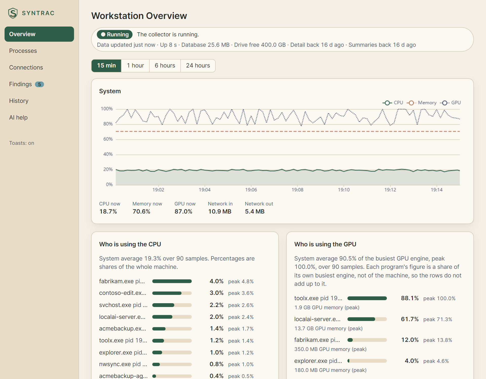
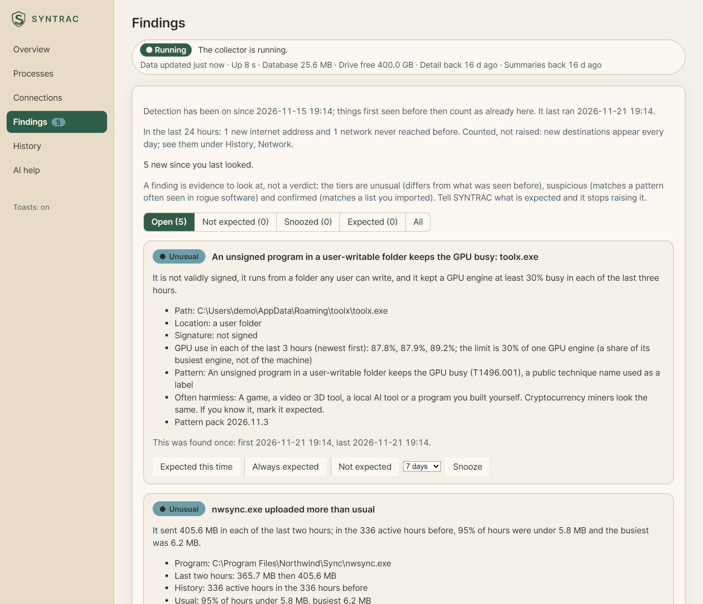
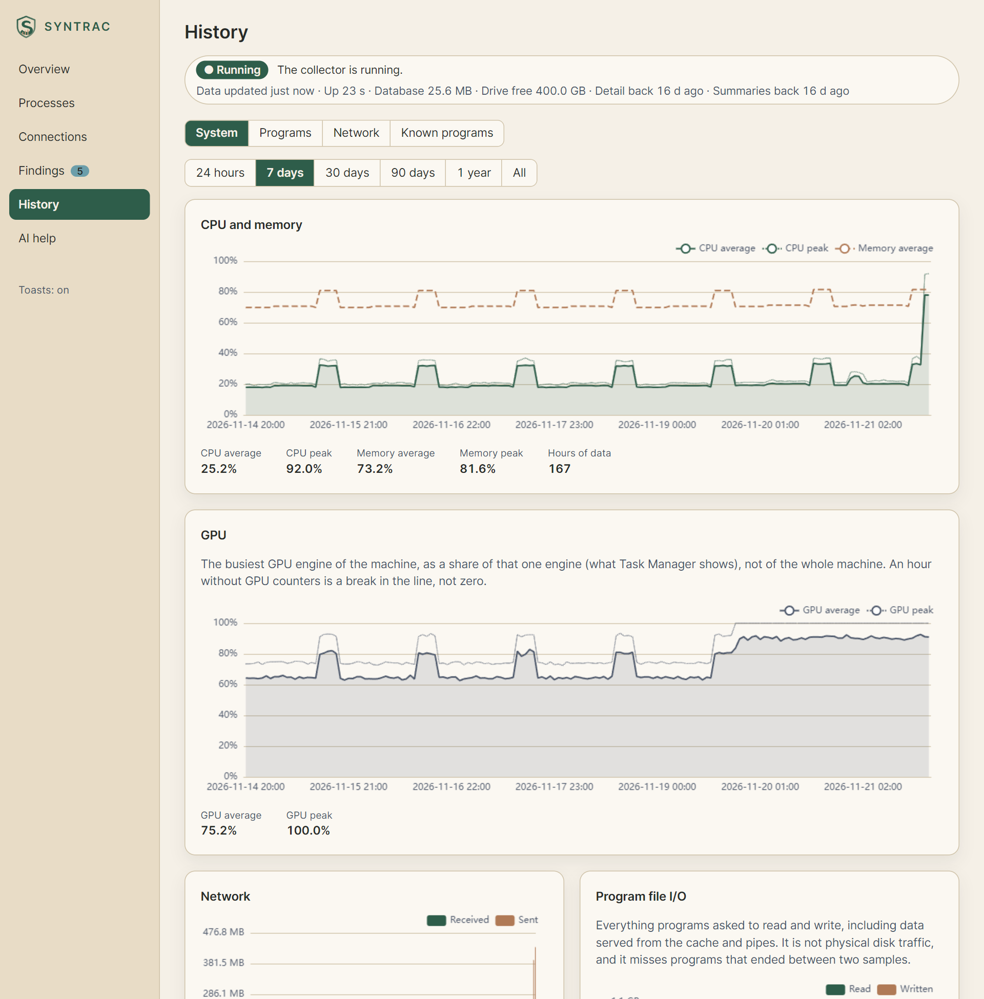
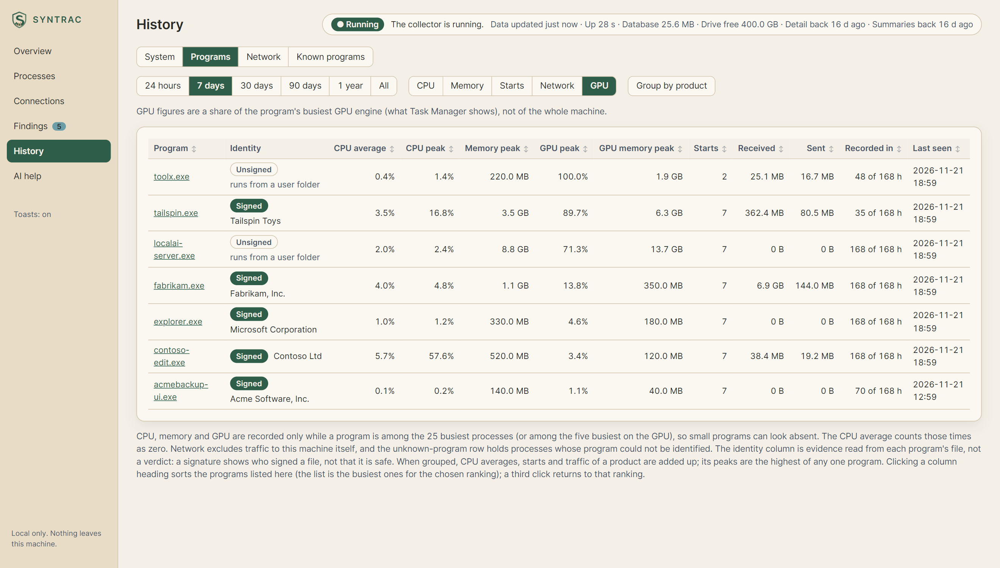
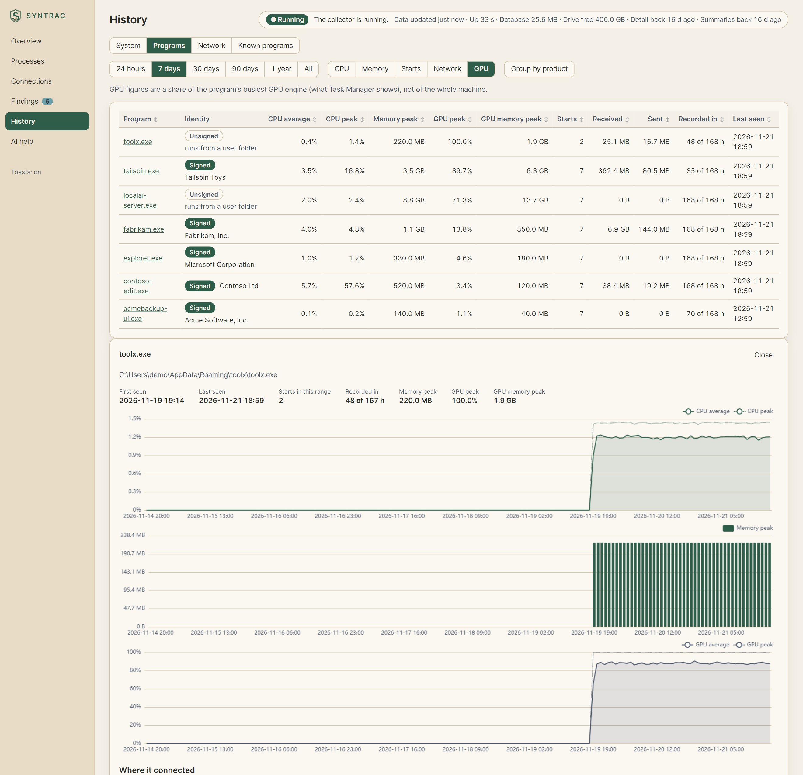
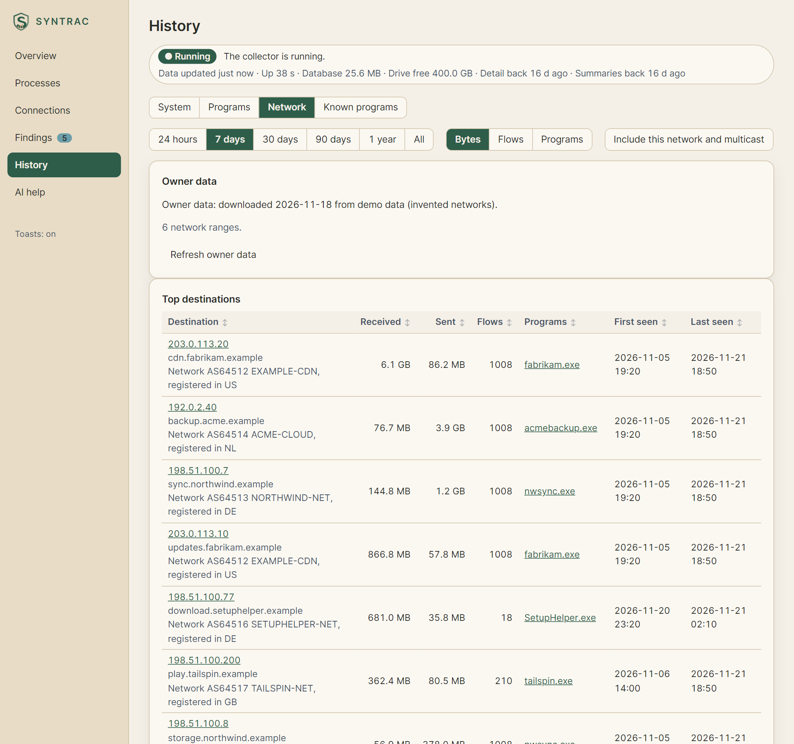
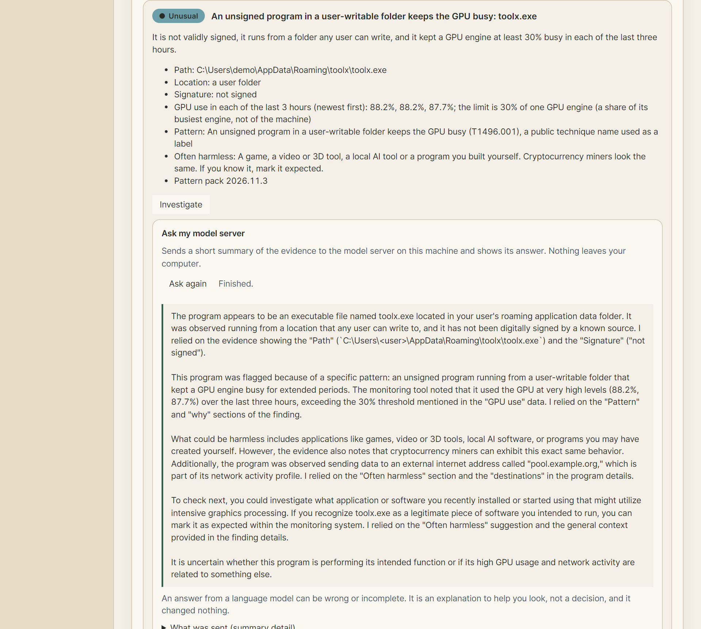
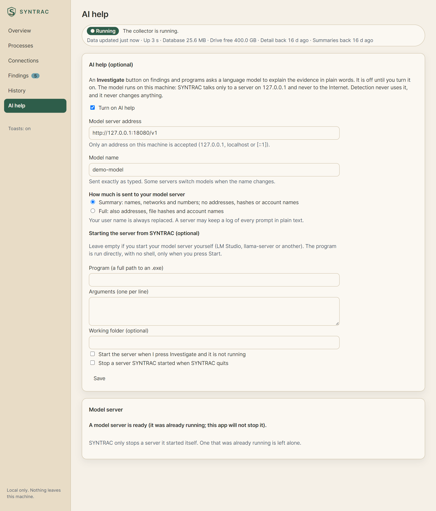
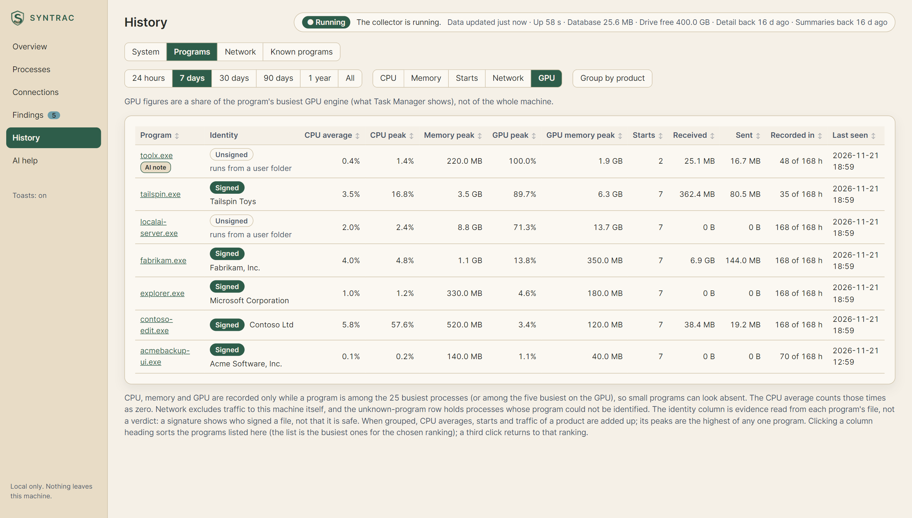

# SYNTRAC

**System intelligence and activity tracking for Windows.** A personal workstation watcher that answers three questions:

1. **What is happening?** Which programs run, what they use, who they talk to, how they start.
2. **What is normal?** Every program is compared with its *own* history, not with a generic rule.
3. **What is unusual?** Explainable findings: what was seen, what it was compared with, the numbers, and what could be harmless.
   An anomaly is not a threat, and SYNTRAC never calls anything malicious.

**Local-first.** Everything stays on your machine. There is no account, no cloud and no telemetry. The one exception only happens when
you press its button: *Download owner data* fetches a single public-domain file that says which network owns each range of internet
addresses, and sends none of your addresses. It can be switched off for good with `owner_data_allowed = false`.

<p align="center">
  
</p>

<sub>Every screenshot here is made from an invented machine (fictional programs, makers and addresses), not from real data; see
[the demo](#try-it-in-two-minutes).</sub>

## What it does

- **Sees everything that runs.** Processes, network connections, DNS answers, CPU, memory, **GPU** and traffic per program, collected
  by a Windows service through ETW and the performance counters. Its own CPU use is logged, and in testing it stayed well under one
  percent of a core.
- **Keeps a history that outlives the detail.** Detailed rows are kept for two weeks by default; hourly summaries are kept for good,
  so you can look back months, with a storage guard that keeps it from filling your drive.
- **Knows who made a program.** Signature, maker, version, hash, where it runs from, how it starts (services, scheduled tasks, Run
  keys, Startup files), and which account it runs as. Evidence, never a verdict.
- **Raises findings you can act on.** A new program, a new way to start with Windows, a changed file, a program that suddenly uses far more
  than it ever has, or one of a short list of well-known patterns (each tied to a public ATT&CK technique name and a plain statement of
  what is probably harmless). You decide: expected this time, always expected, raise the limit, snooze.
- **Tells you without getting in the way.** A tray icon, Windows toasts for new suspicious findings (with or without the window open),
  and an optional start with Windows.
- **Optionally explains in plain words.** An off-by-default Investigate button asks a model on your own machine (LM Studio, llama-server or similar; loopback only), or prepares a reduced text you can copy to an outside assistant yourself. It remembers the answers, so a program you already looked into is marked and needs no second question.

<p align="center">
  
</p>

## Try it in two minutes

You can run the real app on a **fictional** machine, with nothing installed and nothing real read or written:

```powershell
powershell -ExecutionPolicy Bypass -File scripts/dev/run-demo.ps1
```

It generates a demo database (sixteen days of invented history, run through the real rollups and the real detection rules), starts a
stand-in for the service, and opens the app. Add `-WithModel` to also try the [AI help](#ai-help-optional-off-by-default) against a stand-in
model server that gives a canned answer. Requirements: Windows 11, Rust (MSVC), Node.js 22+ and pnpm.

## Screens

<table>
  <tr>
    <td width="50%"><br><sub><b>History, System.</b> A week of CPU, memory and GPU, kept as hourly summaries.</sub></td>
    <td width="50%"><br><sub><b>History, Programs.</b> Ranked by CPU, memory, starts, network or GPU, with who made each one.</sub></td>
  </tr>
  <tr>
    <td width="50%"><br><sub><b>One program.</b> Its own history hour by hour, its identity and what it connected to.</sub></td>
    <td width="50%"><br><sub><b>History, Network.</b> Destinations, the names programs asked for, and the network that owns each.</sub></td>
  </tr>
</table>

## AI help (optional, off by default)

An **Investigate** button on findings and programs asks a language model that runs **on your own machine** (LM Studio, `llama-server`,
your own loader, or any server that speaks the common chat API on `127.0.0.1`) to explain the evidence in plain words, and shows exactly what
was sent. SYNTRAC never talks to the Internet for this; detection never uses it; an answer is an explanation, not a decision.

- **Your server, your model.** The AI help tab takes the address (only this machine is accepted), the model name and how much detail to send. If you
  like, it can also **start your model server for you**: it shows the exact command first, runs it only when you press **Start** (never a script,
  never a shell), shows the server's output if it ends, and stops only a server it started itself.
- **It tells you what it is doing.** A model that thinks before it answers can take a minute or two for its first words; the page says it is thinking
  and how far it has got, and an answer that hit the model's length limit is marked **cut off** instead of looking finished.
- **It remembers.** A finished answer is saved on your machine with its date and model. Open **Investigate** on the same program later and the saved
  answer appears at once, with **Ask again** and **Forget the saved answer**. A small **AI note** beside a program or finding shows what you have
  already looked into.
- **Or use an outside assistant yourself.** SYNTRAC can prepare a much more reduced text (no file names, folders, addresses or finding sentences)
  for you to look at, edit and copy. It sends nothing itself.

<p align="center">
  
</p>

<sub>An answer from a small local model on the demo machine. [docs/USER-GUIDE.md](docs/USER-GUIDE.md) explains the settings and what is sent.</sub>

<table>
  <tr>
    <td width="50%"><br><sub><b>AI help tab.</b> Off until you turn it on; the server's state, and the exact command a Start would run.</sub></td>
    <td width="50%"><br><sub><b>Remembered answers.</b> An <i>AI note</i> marks a program (or finding) that was investigated before.</sub></td>
  </tr>
</table>

## Quick start (installing for real)

SYNTRAC is two parts: an elevated Windows **service** that collects the data into a local SQLite database, and an unelevated
**Tauri 2 + React app** that reads it. There is no installer yet; both are built from this repository.

```powershell
# build and check everything (format, lint, build, tests, file sizes)
powershell -ExecutionPolicy Bypass -File scripts/dev/verify.ps1

# the service: build, then install from an ADMINISTRATOR PowerShell (your own account id comes from a normal one)
cargo build --release -p syntrac-service
[Security.Principal.WindowsIdentity]::GetCurrent().User.Value
powershell -ExecutionPolicy Bypass -File scripts/deploy/install-service.ps1 -UserSid <your id>

# the app
cd app; pnpm install; pnpm tauri build --no-bundle
..\target\release\syntrac-app.exe
```

The [user guide](docs/USER-GUIDE.md) covers installing, every screen, what findings mean and what you can do about them, the tray,
settings, where your data lives, troubleshooting, and what SYNTRAC cannot tell you.

## Documentation

| | |
|---|---|
| [User guide](docs/USER-GUIDE.md) | Installing, the screens, findings, the tray, settings, privacy, troubleshooting |
| [Architecture](docs/ARCHITECTURE.md) | How the pieces fit: service, app, store, pure core and its interfaces |
| [Threat model](docs/THREAT-MODEL.md) | What each part trusts, what it protects, and what is accepted |
| [Schema](docs/SCHEMA.md) | The database, migration by migration |
| [Known patterns](docs/PATTERNS.md) | The pattern pack: every rule, its technique label, its harmless explanation |
| [Plans](docs/PLAN.md) | The project plan and the slice plans behind each feature ([alerts](docs/ALERTS-PLAN.md), [identity](docs/IDENTITY-PLAN.md), [storage](docs/STORAGE-PLAN.md), [network](docs/NETWORK-PLAN.md), ...) |
| [Change logs](aiChangeLog/) | One file per slice: what changed, what was measured, what was left out and why |
| [Third-party material](THIRD-PARTY.md) | ATT&CK labels, the owner data source and dependency licences |

## How it works

```
Windows ETW (processes, network, DNS) + performance counters (CPU, memory, GPU)
        |
        v
  syntrac-service  (elevated, runs as the "Syntrac" Windows service)
   sources -> correlate -> SQLite (raw detail, 14 days) -> hourly rollups + permanent ledgers
   workers: file identity, account and service context, launch entries, findings
        |  named pipe: status and the few write requests (decide a finding, mark a program known)
        v
  syntrac-app  (your account, read-only on the database)
   Overview, Processes, Connections, Findings, History  +  tray icon, toasts
        |  optional, off by default: only when you press Investigate or Start
        v
  a model server on 127.0.0.1 (yours: LM Studio, llama-server, ...)  ->  answers kept in a small file next to the settings
```

Pure logic lives in `syntrac-core` behind interfaces, so the whole pipeline runs offline against mocks. The same repository contract
tests run against an in-memory store and the SQLite store, so they cannot drift apart.

## Status

Built: collection (ETW, snapshots, metrics, GPU), storage with rollups and a storage guard, program identity and
how programs start, the network and owner views, findings (new things, usage, known patterns), live and historical GPU views, the tray
icon with toasts and start with Windows, and the demo. An optional, off-by-default **AI help** is built: an Investigate button that asks a model server on this machine (which it can start for you, on a button), remembers the answers, and can prepare a reduced text to copy for an outside assistant. Not built: a process tree and connection map, and an installer. [docs/PLAN.md](docs/PLAN.md) has the full plan.

## Development

There is deliberately **no hosted CI**: `scripts/dev/verify.ps1` is the gate (formatting, lint with warnings as errors, build, tests, and a
file-size check), and it is run before every push. Frontend tests run with `pnpm test` in `app/`.

| Path | Purpose |
|---|---|
| `crates/syntrac-core` | Domain types, interfaces and pure logic (correlator, rollups, detection rules, patterns) |
| `crates/syntrac-store` | SQLite repositories and migrations |
| `crates/syntrac-collector` | Telemetry sources (ETW, snapshots, metrics, GPU counters) and enrichers |
| `crates/syntrac-service` | The Windows service host and its workers |
| `crates/syntrac-ipc` | The named-pipe protocol and server |
| `crates/syntrac-llm` | The optional AI help's client for a model server on this machine (loopback only) |
| `crates/syntrac-testkit` | Mocks, an in-memory repository, fixtures and the repository contract suites |
| `crates/syntrac-demo` | The fictional machine and its data generator, for screenshots and trying the app |
| `app/` | The Tauri 2 shell and the React/TypeScript screens |
| `config/` | The service settings and the pattern pack |
| `docs/` | Plans, architecture, schema, threat model, user guide |
| `scripts/` | `dev/` (verify, demo), `deploy/` (install, move data, uninstall, smoke test) |

The look is a light cream-and-sand theme from the SYNTRAC brand kit in `docs/branding/`; colours live only in
`app/src/theme/tokens.css` and are checked against WCAG AA by a test.

## Licence

[MIT](LICENSE). See [THIRD-PARTY.md](THIRD-PARTY.md) for the material SYNTRAC builds on.
