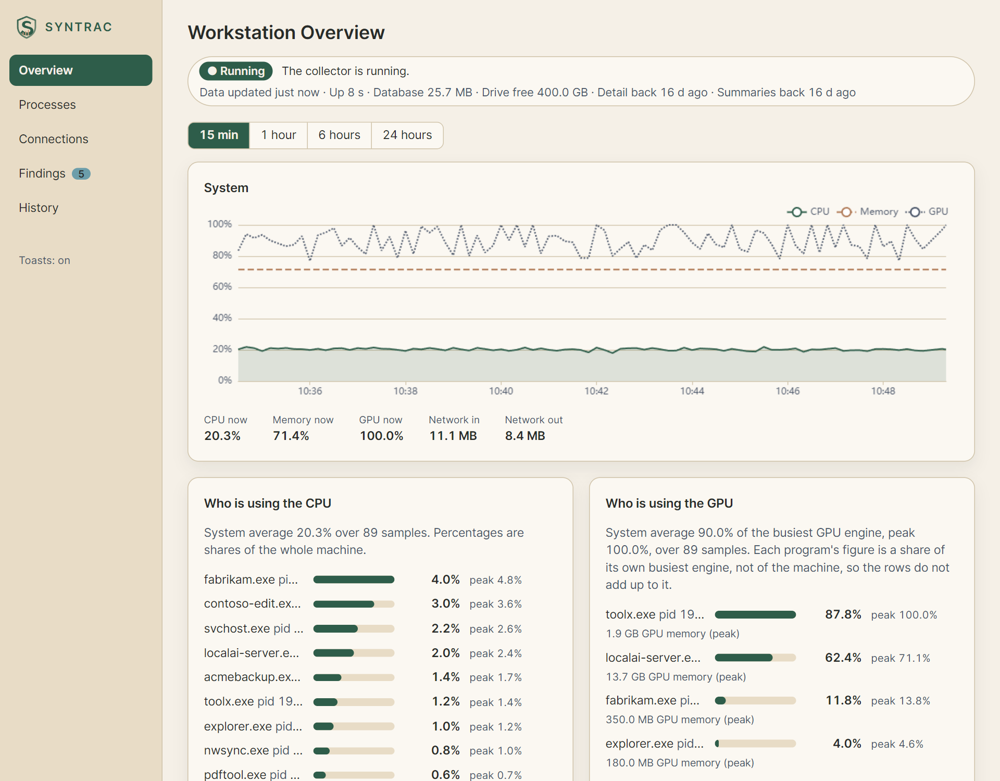
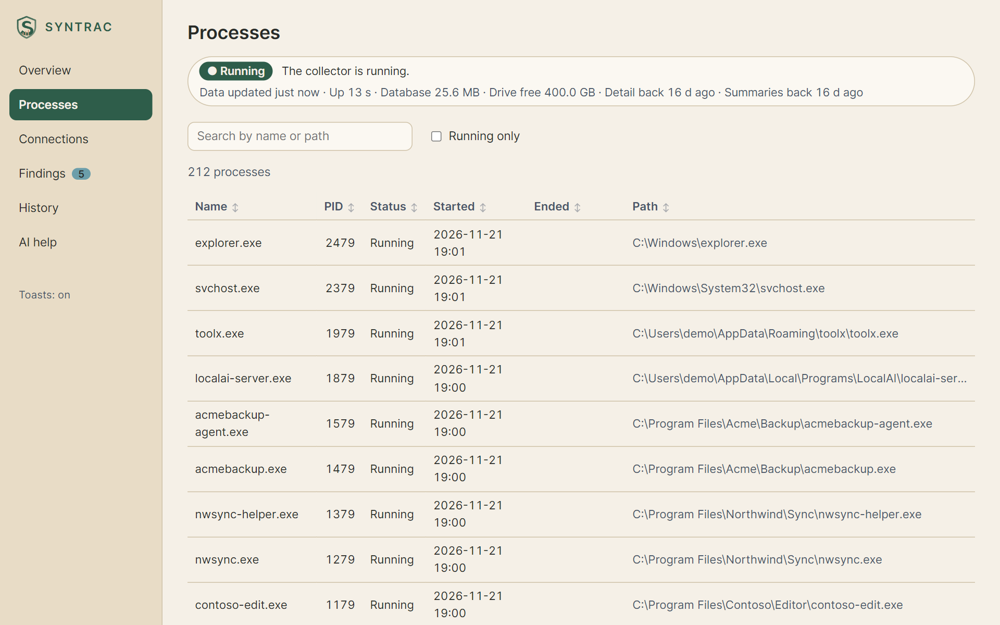
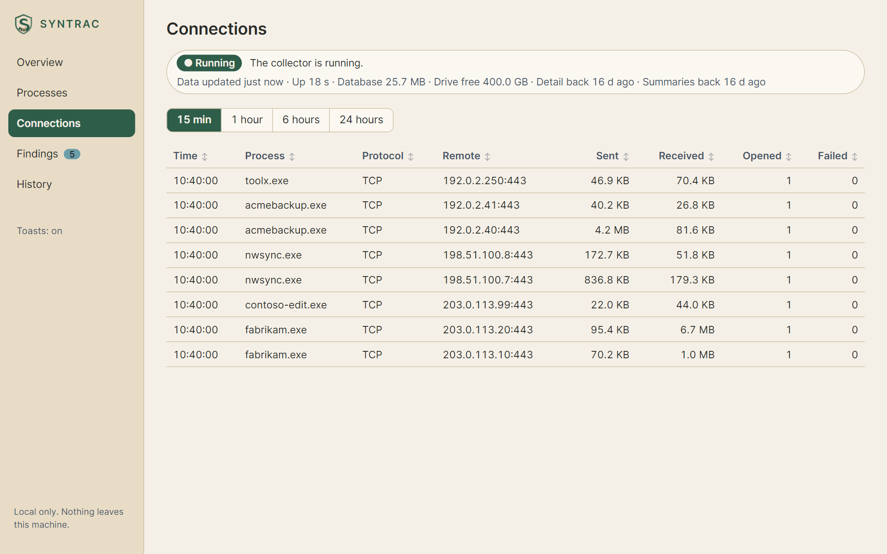
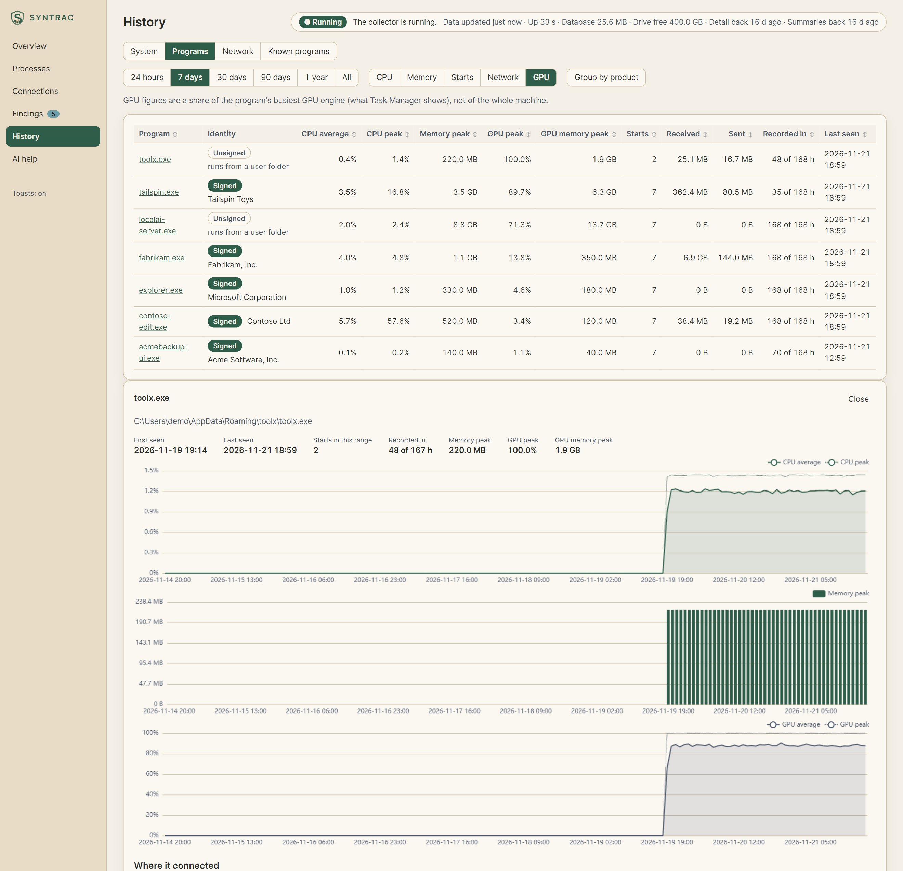
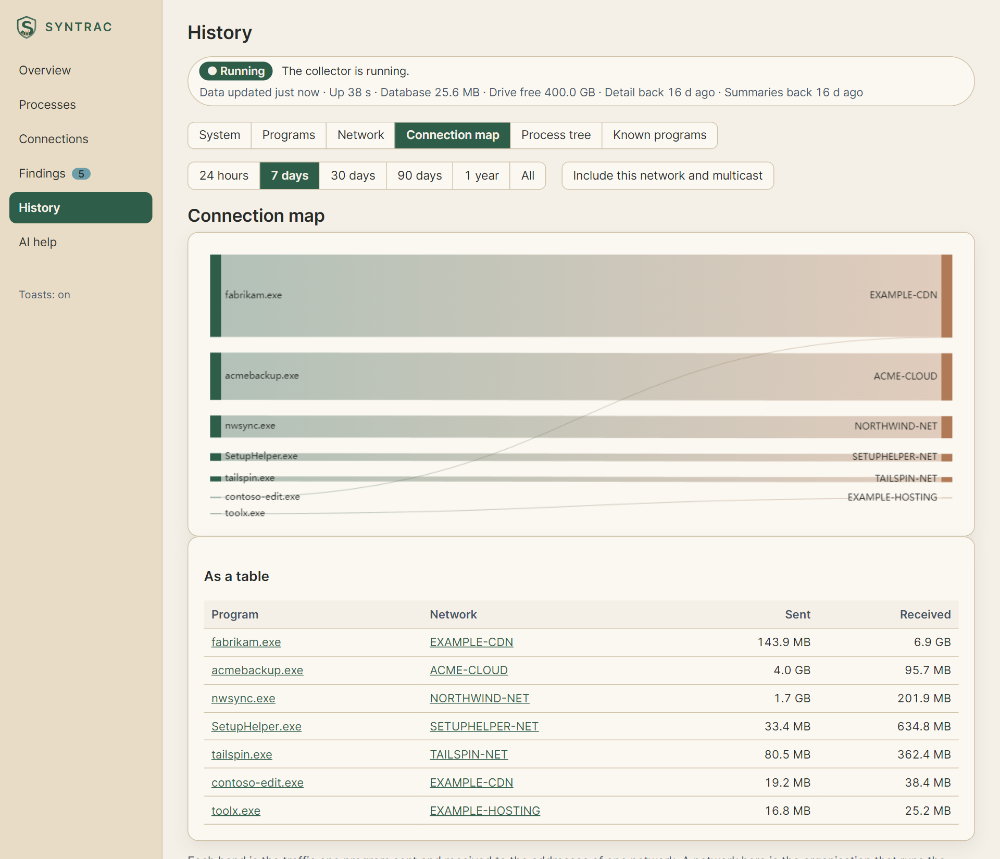
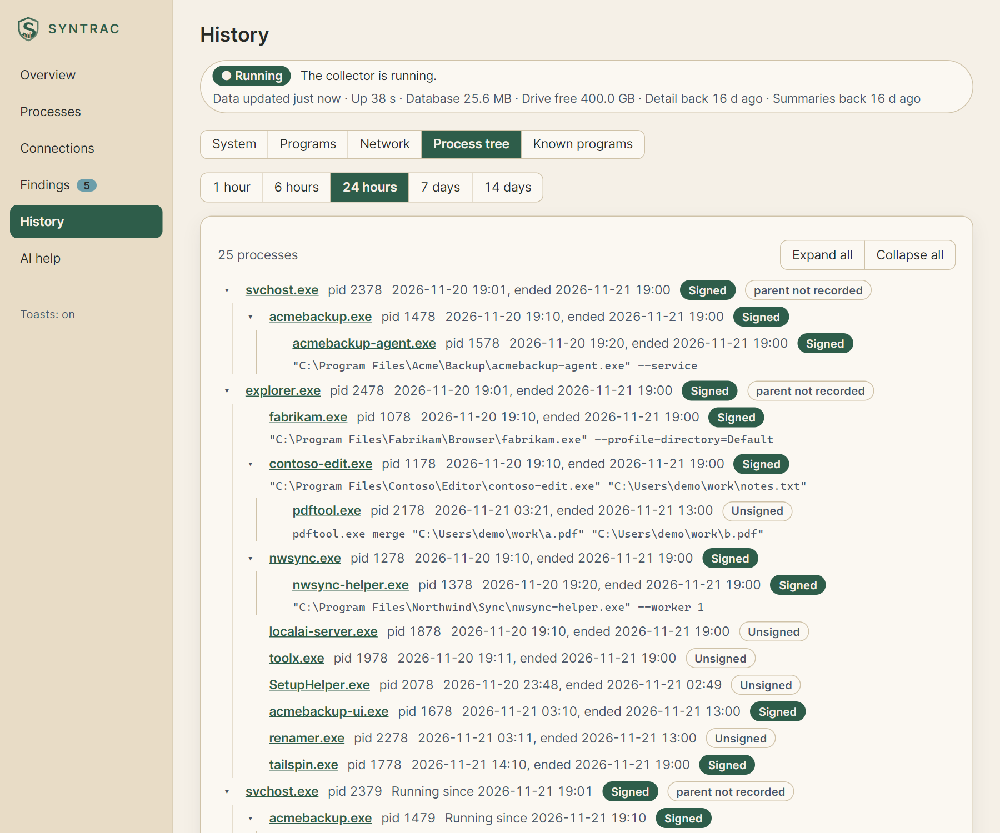
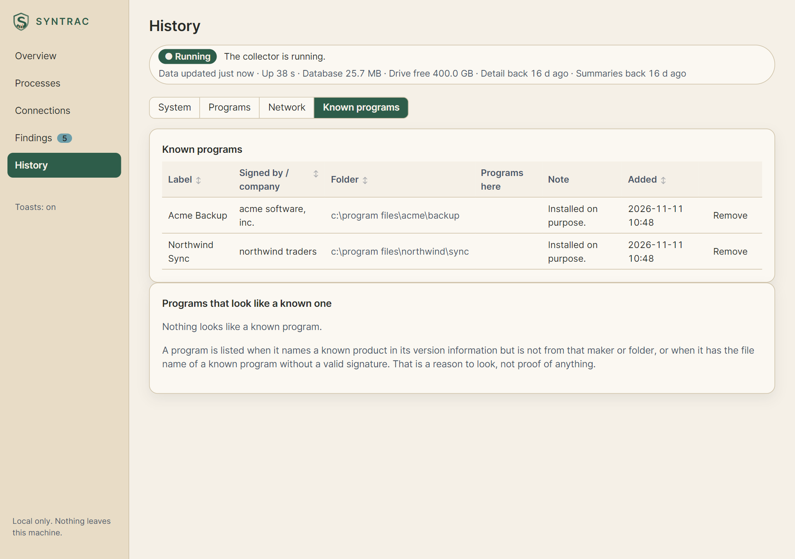
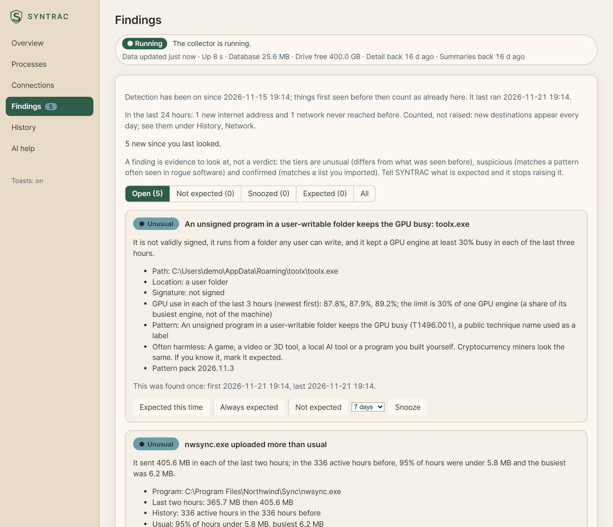

# SYNTRAC user guide

SYNTRAC watches what your Windows PC is doing and keeps a local record of it: which programs run, what they use, who they talk to, and
what is new or unusual. It is built to answer three questions: **What is happening? What is normal? What is unusual?**

It is **not** antivirus and it never says a program is malicious. It shows evidence (what it saw, what it compared it with, and what could
be a harmless reason) and leaves the decision to you. Everything stays on your machine.

- [Installing](#installing)
- [Try it without installing: the demo](#try-it-without-installing-the-demo)
- [The screens](#the-screens)
- [Findings: what they mean and what you can do](#findings-what-they-mean-and-what-you-can-do)
- [Notifications, the tray icon and starting with Windows](#notifications-the-tray-icon-and-starting-with-windows)
- [GPU use](#gpu-use)
- [Settings](#settings)
- [Your data and your privacy](#your-data-and-your-privacy)
- [Troubleshooting](#troubleshooting)
- [What SYNTRAC cannot tell you](#what-syntrac-cannot-tell-you)

## Installing

SYNTRAC has two parts. A **service** (it runs as the Windows `Syntrac` service with administrator rights, because reading process and
network events requires them) collects the data and writes it to a local SQLite database. The **app** (it runs as you, with no special
rights) reads that database and shows it. They are built from this repository; there is no installer yet.

**You need:** Windows 11 (x64), the Rust toolchain (stable, MSVC) with the Visual Studio C++ Build Tools, Node.js 22 or later, and pnpm.
The WebView2 runtime ships with Windows 11.

1. **Build and check** (optional but recommended; it runs the whole test suite):
   ```powershell
   powershell -ExecutionPolicy Bypass -File scripts/dev/verify.ps1
   ```
2. **Build the service:**
   ```powershell
   cargo build --release -p syntrac-service
   ```
3. **Install the service.** Find your own account's id first, in a normal (not administrator) PowerShell, then install from an
   **administrator** PowerShell. The id says which person may read the data with the app.
   ```powershell
   [Security.Principal.WindowsIdentity]::GetCurrent().User.Value
   powershell -ExecutionPolicy Bypass -File scripts/deploy/install-service.ps1 -UserSid <your id>
   ```
   Running it again upgrades the service in place and keeps your settings. The program and its settings go in
   `C:\Program Files\Syntrac` (only administrators can change them, which keeps the service safe from tampering); the data goes in
   `C:\ProgramData\Syntrac` unless you choose another place (see [Your data](#your-data-and-your-privacy)).
4. **Build the app and run it:**
   ```powershell
   cd app
   pnpm install
   pnpm tauri build --no-bundle
   ..\target\release\syntrac-app.exe
   ```
   The first screen is the Overview. Give the service a few minutes to write its first samples.

**Updating:** build both again, run the install script again, and run the new app. The service and the app must be the same version
(they share the database format); if they differ, the app says so.

**Uninstalling:** run `scripts/deploy/uninstall-service.ps1` from an administrator PowerShell. It keeps your data unless you pass
`-RemoveData`.

## Try it without installing: the demo

You can run the real app on a **fictional** machine, with nothing installed and nothing real read or written:

```powershell
powershell -ExecutionPolicy Bypass -File scripts/dev/run-demo.ps1
```

It builds a demo database of invented programs (made-up companies, documentation-range addresses), starts a stand-in for the service, and
opens the app on it. It uses its own app identity and its own per-user folder, so a SYNTRAC you already run is not touched. Everything
it makes is in one new folder under `%TEMP%`. The pictures in this repository's README were taken this way
(`scripts/dev/run-demo.ps1 -Capture docs/images`).

To try the [AI help](#ai-help-optional) on the demo, add `-WithModel`: the script also starts a **stand-in model server** (it answers with a
canned text that says it is not a language model) and turns the AI help on, pointed at it, in the demo's own settings file. You can also
point the demo at your own model server on the AI help tab: the demo data is invented, so nothing real is sent. `-CheckAi <folder>` drives
the AI help through the real app and writes a report and pictures to that folder; it also reads the stand-in's request log to check what a
model server would have received (no user name in a path, no addresses at the summary level). To try a real model server on the demo instead of the stand-in, use `-LiveAi <folder> -ModelEndpoint http://127.0.0.1:1234/v1 -ModelName <the name your server knows>`: it asks about one demo finding, waits as long as the model needs, and saves the answer and a picture. Some servers (LM Studio) load a model into memory the first time it is asked for, so the first answer can take a while.

## The screens



**The banner** at the top of every screen is the service's health: **Running**, **Stale** (the service answers but its newest data is old),
**Degraded** (something specific is not being recorded, and it says what), **Offline** (nothing is listening: the service is stopped or not
installed) or **Unknown**. When the service is offline, the screens still show the data already stored.

**Overview.** The last 15 minutes, hour, 6 hours or day. The *System* chart draws CPU and memory as shares of the whole machine and the
GPU as a dotted line (a share of its busiest engine). *Who is using the CPU* lists the programs that used it, as a share of the whole
machine; the rows add up to the system average together with "everything else" and "not attributed to any process" (interrupt and driver
time, and programs SYNTRAC is not allowed to read). *Who is using the GPU* does the same for the GPU. *Network destinations* lists where
traffic went.



**Processes** lists every process SYNTRAC has recorded, with its id, whether it is still running, when it started and ended, and its path. **Connections** lists
recent network activity, with the program that made it.



**Findings** is where new and unusual things appear. See [Findings](#findings-what-they-mean-and-what-you-can-do).

**History** keeps what the live screens cannot: hourly summaries are kept for good, so you can look back days, months and a year.

- **System:** CPU and memory, the GPU, network traffic and *program file I/O* (what programs asked to read and write, which is not
  physical disk traffic).
- **Programs:** the programs ranked by CPU, memory, starts, network or GPU, over the range you choose. "Group by product" adds the
  executables of one product (for example a backup tool's service, agent and control panel) into one row. Click a program for its own
  history, who made it (the **identity** badge: signed or unsigned, by whom, where it runs from), how it starts, what it talked to, and
  what you have said about it.
- **Network:** the destinations programs talked to, by bytes, flows or programs, with the network that owns each address and the name
  programs asked for. This tab also holds *Owner data* (see [your privacy](#your-data-and-your-privacy)).
- **Connection map** (picture below): which programs talked to which networks over the range you choose, as bands as wide as the traffic.
  Programs are on the left and the networks that own the addresses they reached on the right, busiest first; everything beyond the busiest
  dozen on each side is added together in one *other* node, so the bands always add up. Click a program for its history, or a network for its
  owner and its busiest addresses (each opens like in the Network tab). A table below the picture holds the same figures for anyone who cannot
  use the picture. A network is the organisation that runs the range of addresses, often a cloud or hosting company, not necessarily the
  service you reached; addresses no range covers are shown together as *No owner found*, never guessed.
- **Process tree** (picture below): who started whom over the last hour to two weeks. A program sits under the one that started it, with
  when it started and ended, what it was started with (the command line, cleaned and cut) and who made it. Click a name for that program's
  history. A program whose starter was not running in the window, or was not recorded, is listed on its own and marked *parent not
  recorded*. Per-process detail is kept for 14 days, so that is as far back as it can look; a very large tree is cut (nearest the top is kept)
  and says how many were left out.
- **Known programs** (picture below): the products you have told SYNTRAC you installed on purpose. They are never raised as new, and a program that
  *looks* like one of them but is not (a look-alike) is listed so you can check.









Clicking a column heading sorts the table; a third click returns to the original order.

## Findings: what they mean and what you can do



A **finding** is evidence worth a look. Each one says what was seen, what it was compared with, the numbers, and **what could be
harmless**. There are three tiers:

- **Unusual:** it differs from what was seen before (a new program, a program using far more than its own history).
- **Suspicious:** it matches a pattern often seen in rogue software, or a new program that is not signed and runs from a folder anyone can
  write to. It is a reason to look, not a verdict.
- **Confirmed:** reserved for a match against a list you import. There is no list import yet, so you will not see this tier.

**What raises a finding:**

| Kind | What it means |
|---|---|
| New program | A program first seen after detection was switched on |
| New start entry | A new way for a program to start with Windows (a service, scheduled task, Run key or Startup file) |
| Changed file | The same path now holds a different file |
| New account | A program now runs under a different account |
| New network owner | An unsigned program connected to a network it never used before |
| Usage | A program used clearly more than it usually does: more than 3 times its own usual (95th percentile) and 1.5 times its busiest hour, over a floor, for two hours in a row (or ten times its busiest hour of uploading in one hour). CPU, memory, GPU, GPU memory, bytes sent and bytes received |
| Known pattern | One of a fixed set of rules (in `config/patterns`) tied to a public ATT&CK technique name, such as a remote-access tool, a name pretending to be a Windows program, or an unsigned program that keeps the GPU busy for hours. See [docs/PATTERNS.md](PATTERNS.md) |

**Your decisions** (buttons under each finding):

- **Expected this time:** it is fine now; if it comes back it is raised again.
- **Always expected:** stop raising this. You choose how wide: *only this program*; *everything below this folder* (offered only for
  folders ordinary programs cannot write to, such as `Program Files`, because a program could otherwise just copy itself into an
  expected folder); or, for developer folders only, *new programs in this build folder* (it silences only the "new program" finding there,
  and the programs it hides are counted in the daily summary so they are never invisible).
- **Raise the limit to this level** (usage findings): the level measured becomes what you accept; it is raised again only if the
  program uses more.
- **Not expected:** keep it visible as a concern.
- **Snooze:** hide it for 1 to 365 days.

Decisions are listed on the Findings screen ("What you told SYNTRAC is expected"), with who said it and when, and can be removed.

**Review what is here today** (at the bottom of the Findings screen) groups the programs that were already on the machine when detection
was switched on, by folder and maker, so you can mark the ones you know in a few clicks instead of waiting for each to be raised. A
folder that ordinary programs can write to is marked program by program, never as a whole folder.

**The first days.** Detection counts *new* from the moment it was switched on, and a program's usage is judged against its own history, which
needs about 48 active hours before it is compared. Expect the screen to be quiet at first and to get better with time.

## Notifications, the tray icon and starting with Windows

SYNTRAC keeps running in the **tray** (the notification area near the clock) so you can close its window and still be told about new
findings.

- **Closing the window** frees the window's memory and leaves the program in the tray. **Left-click the icon** (or *Open SYNTRAC*) to
  bring the window back. **Quit** in the tray menu ends the program. Starting SYNTRAC a second time just opens the running one.
- **The tooltip** says how many findings are open, or that the collector is not running.
- **Notifications** (a check mark in the tray menu, also *Toasts: on/off* in the sidebar) raise a Windows toast for each new *suspicious*
  finding, at most three at a time, then one line saying how many more; *unusual* findings come as one summary line, never one each. A
  finding raised while the program was not running is announced the next time it starts. The very first run announces nothing. Toasts
  show the finding's title and reason on screen, so turn them off if you share your screen.
- **Start with Windows** (a check mark in the tray menu, **off until you tick it**) writes one value, `SYNTRAC`, in your own Run key
  (`HKCU\Software\Microsoft\Windows\CurrentVersion\Run`): `"<this program>" --tray`, which starts with only the tray icon and no window.
  Unticking removes it. No administrator rights, no scheduled task. Windows' own Startup apps list can disable it as well; SYNTRAC does
  not read that switch.
- The tray icon may be under the **^** arrow; drag it to the taskbar to keep it visible.

Your settings (notifications on or off, and the newest finding announced) are in `%LOCALAPPDATA%\Syntrac\app.json`. Answers kept by the optional AI help are in `investigations.json` in the same folder.

## GPU use

SYNTRAC reads the Windows GPU counters every few seconds and records, for each program, how busy the **busiest GPU engine** it uses is
(the figure Task Manager shows) and its dedicated GPU memory. It is a share of **one engine**, not of the whole machine, so the rows do
not add up to the system figure. Where it appears: the Overview chart and *Who is using the GPU*, History (System, and Programs ranked by
GPU), and the usage and pattern rules. A machine without the counters records "not available", which is shown as a gap, never as an idle
GPU. Reading the counters costs about 2 milliseconds per sample; switch it off with `gpu_metrics_enabled = false`.

A GPU-heavy unsigned program in a user folder is not necessarily malicious (games, video tools and local AI tools all do this), and
cryptocurrency miners look the same. That is why it is an *unusual* finding with the harmless reasons written in, and why you can mark a
program you run on purpose as expected.

## Settings

The service reads `config/service.toml` (installed in `C:\Program Files\Syntrac\config`, editable only as an administrator; the install
script keeps your edits). Restart the service to apply a change: `Restart-Service Syntrac` from an administrator PowerShell. Every
setting is explained in the file; an unknown key is rejected rather than ignored. The ones you are most likely to want:

| Setting | Default | What it does |
|---|---|---|
| `detail_retention_days` | 14 | How long the detailed rows are kept; they are deleted only after being summarised into the hourly rollups, which are kept |
| `max_database_gb`, `min_free_space_gb`, `hard_floor_free_gb` | 10, 20, 5 | The storage guard: trims the oldest summarised detail early, and pauses detail collection if the data drive gets nearly full |
| `detect_enabled` | see the file | Whether findings are raised at all |
| `patterns_enabled` | false | Whether the known patterns are matched (read [docs/PATTERNS.md](PATTERNS.md) first) |
| `gpu_metrics_enabled` | true | Whether the GPU counters are read |
| `usage_*` | see the file | The usage rule's history length and floors (`usage_gpu_floor_percent`, `usage_memory_floor_mb`, ...) |
| `owner_data_allowed` | true | Set to `false` to make the service refuse to download anything, ever |
| `launch_enabled`, `context_enabled` | true | How programs start (services, tasks, Run keys), and which account each program runs as |

## AI help (optional)

An **Investigate** button on findings and programs can ask a language model to explain the evidence in plain words: what the program
probably is, why it was flagged, what could be harmless, and what to check next. It is **off until you turn it on** (the **AI help** tab),
detection never uses it, and it never changes anything or decides anything. Treat an answer as an explanation to help you look, not as a
verdict: a model can be wrong.

**Two ways to use it, both optional:**

1. **A model server on this machine.** Any server that speaks the common chat API works (LM Studio, `llama-server` and others). Enter its
   address (only `127.0.0.1`, `localhost` or `[::1]` is accepted, so nothing is ever sent to the Internet by SYNTRAC) and the model name
   exactly as the server knows it. Press **Investigate with my model**; the answer streams in, and **Stop** ends it. *What was sent* shows the
   evidence block the answer was based on.
2. **Copy a prompt for an outside assistant.** *Show the text to copy* builds a much more reduced text: no file names, folders, product names,
   network owners, host names, addresses or finding sentences, only the kind of finding, the signature state, the publisher, the kind of
   place the program runs from, and numbers. You can edit it, then **Copy to clipboard**. SYNTRAC sends nothing: pasting it into a hosted
   assistant is your own action and shares it with that service.

**How much your own server is told** (the setting *How much is sent*): *Summary* (the default) gives names, networks and numbers without
addresses, hashes or account names; *Full* adds addresses, file hashes and account names. Your Windows user name is always replaced by
`<user>`. Some model servers keep a log of every prompt in plain text: check yours.

**Starting the server from SYNTRAC (optional).** If you give a full path to the server's `.exe` (and its arguments), the AI help tab shows
the exact command and a **Start the model server** button; nothing starts until you press it (or tick *Start the server when I press
Investigate*). Only a full local path to an `.exe` is accepted (no scripts, no network, temporary or download folders). SYNTRAC only ever
stops a server **it started itself**, and only when you press Stop (or tick *Stop ... when SYNTRAC quits*). Leave the launch command empty if
you start the server yourself.

**Saved answers.** When an answer finishes, SYNTRAC keeps it (in `investigations.json` next to `app.json`), together with the model's name, the
detail setting, the date and what was sent. Open **Investigate** on the same program or finding later and the saved answer is shown at once with
its date; nothing is asked of the model until you press **Ask again**. A small **AI note** beside a program (History, Programs) or a finding
shows that an answer is saved, so you can see what you have already looked into. **Forget the saved answer** removes it. A stopped or failed
investigation keeps nothing, and a cut-off answer is kept but still says it was cut off. The newest 500 answers are kept. The file stays on
this machine; with the *Full* detail setting an answer was written from addresses and account names, so it may repeat some of them.

**Ask a question.** With the help on, the AI help tab has an **Ask a question** box. Type a question in your own words, for example "Which
programs were busiest this week?" or "What started `widgetsync.exe`?", and press **Ask**. Your model may look things up with four tools that
only read: a program's facts, the open findings, the busiest programs, and which programs started a given program or were started by it. The
page lists every lookup under *What was looked up* (a refused one says why, a cut one says it was cut), so you can check the answer against
it. It uses at most six lookups and a limited time, then answers from what it gathered; **Stop** ends it. At the *Summary* detail level the
tools give names and numbers only; *Full* adds addresses, hashes and command lines (with the values of arguments named like a token, password
or key hidden). A tool can only read what SYNTRAC recorded: it never reads files from your disk, and it cannot change or start anything. Answers
to questions are not saved. The setting *Start the server when I press Investigate* applies to **Ask** as well. This needs a server and model that support **tool calling**: if yours does not, the box says so (for
`llama-server`, start it with the `--jinja` option and use a model whose chat template supports tools). Some servers hand a tool call back as text (in `<tool_call>` tags) instead of a structured call; SYNTRAC reads that form too. Use **Investigate** instead if it does not.

**If the server will not start or ends.** Set the **working folder** to the folder the server expects to run in: many servers read their
settings file (for example `config.toml`) from the folder they run in, and without it they fall back to built-in defaults and fail. The tab
shows the folder the command runs in (or says there is none). Whatever the server prints is saved in `model-server.log` next to
`app.json` (a new file at each start), and when the server ends the tab shows its last lines, so you can see why. A large model can take
minutes to load, and some servers give up waiting for their model after a fixed time (a setting of that server): if it ends with
"did not become ready" in those last lines, raise that time in the server's own settings.

## Your data and your privacy

- **Everything stays on your machine.** SYNTRAC has no account, no cloud and no telemetry. The optional AI help talks only to a model server on this machine, and only after you turn it on. There is one exception, and it only happens
  when you press its button: **Download owner data** (History, Network) fetches one public-domain file from `iptoasn.com` that says which
  network owns each range of internet addresses. It sends none of your addresses (the lookups happen locally), and
  `owner_data_allowed = false` switches it off for good. Without it, destinations are still shown, just without the network's name.
- **What is stored:** process starts and ends (path, parent, start time; **not** command lines or file contents), network flows
  (program, remote address, port, bytes), DNS answers, CPU, memory, GPU and traffic samples, what each program's file is (signature,
  maker, version, SHA-256), how programs start, what is installed, and your decisions. The account names a program runs under contain
  your Windows user name; they are kept only in the local database.
- **Where:** the default is `C:\ProgramData\Syntrac\data\syntrac.db`; logs are next to it, not inside it. To move it to another fixed
  internal drive (USB, network and nearly full drives are refused), from an administrator PowerShell:
  `scripts/deploy/move-data.ps1 -UserSid <your id> -NewDataDir D:\Syntrac -DryRun` first, then without `-DryRun`.
- **Reading the data:** the database is readable by you (the account the service was installed for) and by administrators. Any program
  running as you could read it too; this is accepted for a personal tool, and [docs/THREAT-MODEL.md](THREAT-MODEL.md) says so.
- **Checking a database:** `target\release\syntrac-service.exe --check-db <path>` reports the schema, integrity and rows per table,
  read-only.
- **AI help:** off by default. What it sends to your own server is limited by the detail setting, and the text for an outside assistant is reduced further and shown to you before anything is copied. Saved answers stay in a file on this machine that you can empty with *Forget the saved answer*.
- **Sharing screenshots:** the app shows program names, paths, and your user name in paths. Look before you post one.

## Troubleshooting

- **The banner says Offline.** The service is not running. In an administrator PowerShell: `Get-Service Syntrac`, then
  `Start-Service Syntrac`. If it is missing, install it (step 3 above).
- **The banner says the database is from a different version.** The service and the app must match: install the service again and
  rebuild the app from the same checkout.
- **Stale or Degraded.** Read the banner: it says what is not being recorded (for example ETW delivering no events, or detail
  collection paused because the data drive is nearly full). `syntrac-service.exe --status` asks the running service the same question.
- **Nothing in Findings.** Normal for the first days (see above). Check that `detect_enabled = true` and that the Findings screen's first
  line says detection has been on since a date.
- **No GPU figures.** Check the service log for "The GPU counters are not available on this machine". Some drivers and virtual machines do
  not provide them. The data only appears in History after an hour has completed.
- **The tray icon does not appear.** Look under the **^** arrow. If you ticked *Start with Windows* and it still does not start after
  signing in, check that the program named in the Run value exists (the app repairs an entry whose program has moved), and that the
  drive it is on is available when you sign in.
- **No toasts.** Check *Notifications* in the tray menu and Windows' own notification settings (including Focus assist). Toasts are only
  for suspicious findings.

## What SYNTRAC cannot tell you

- A program that behaves normally for a week becomes part of its own baseline, so slow changes are easy to miss. That is why *new*
  programs, *new start entries* and *changed files* matter more than usage statistics.
- A name, folder or signature is weak evidence on its own: anyone can name a file anything or sign with a stolen certificate. The known
  patterns catch the careless majority and say so; no match proves nothing.
- Command lines are not stored, so SYNTRAC can say *which* program started which, never what it was told to do.
- A very short burst between two samples (a few seconds) can be missed. In-browser mining shows up as the browser's own GPU use.
- If the service is stopped or the PC is off, nothing is recorded or detected for that time.
